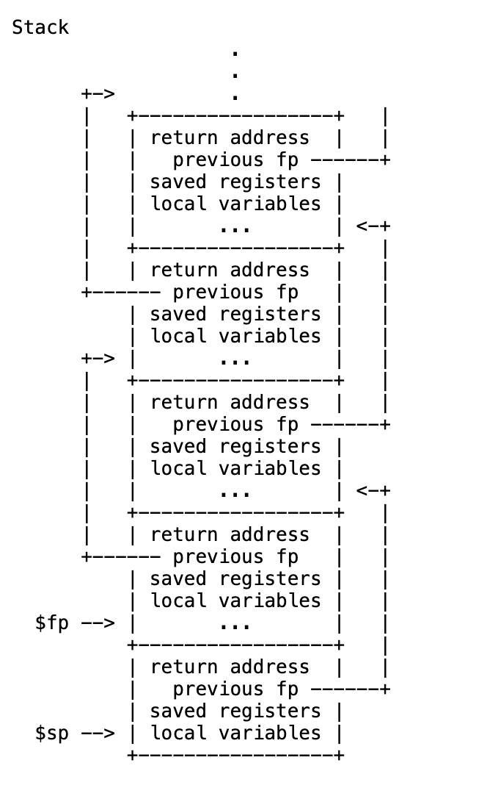

# 一、**RISC-V assembly (easy)**

先来看一下 user/call.asm：

```c
#include "kernel/param.h"
#include "kernel/types.h"
#include "kernel/stat.h"
#include "user/user.h"

int
g(int x)
{
  return x + 3;
}

int
f(int x)
{
  return g(x);
}

void
main(void)
{
  printf("%d %d\n", f(8) + 1, 13);
  exit(0);
}
```

> Q1: 哪些寄存器存储着函数的参数？例如，在 main 函数调用printf时，哪个寄存器保存着参数 13 ？
> 

根据RISC-V的Calling Convention，参数依次存放在a0, a1和a2中。

> Q2: main 函数的汇编代码中，函数f 的调用在哪里 ？函数g的调用在哪里？（提示：编译器可能会内联函数。）
> 

下面是call.c对应的汇编代码，可以看到其中并没有调用函数f和函数g，因为对这两个函数的调用都被编译器内联了。

```nasm
void
main(void)
{
  24:	1141                	addi	sp,sp,-16
  26:	e406                	sd	ra,8(sp)
  28:	e022                	sd	s0,0(sp)
  2a:	0800                	addi	s0,sp,16
  printf("%d %d\n", f(8) + 1, 13);
  2c:	4635                	li	a2,13
  2e:	45b1                	li	a1,12
  30:	00001517          	auipc	a0,0x1
  34:	8c050513          	addi	a0,a0,-1856 # 8f0 <malloc+0xf2>
  38:	70e000ef          	jal	746 <printf>
  exit(0);
  3c:	4501                	li	a0,0
  3e:	2ba000ef          	jal	2f8 <exit>
```

> Q3：printf 函数位于哪个地址？
> 

printf位于地址0x746处。

> Q4：main 函数中printf函数调用jarl 之后， 寄存器ra的值是多少？
> 

printf的返回值是成功打印输出等字符总数，如果出错则返回一个负数。

> Q5: 输出结果是什么？
> 

```cpp
#include <cstdio>

int main() {
	unsigned int i = 0x00646c72;
	printf("H%x Wo%s", 57616, (char *) &i);

	return 0;
}
```

输出的是：“He110 World”。其实就是将i的底层位级表示根据ASCII码解释为字符。

> Q6：在以下代码中，问号之后会打印什么 `'y='`？为什么？
> 

```cpp
#include <cstdio>

int main() {
	printf("x=%dy=%d\n", 3);
	
	return 0;
}
```

在我的Mac上输出的结果为：“x=3y=0”。

根据RISC-V的Calling Convention，第三个参数应该存放在寄存器a2中，这里没有传入第三个参数，所以y的值取决于a2中残留的内容。

# 二、**Backtrace (moderate)**

要求我们在 kernel/printk.c 中实现一个函数 backtrace() ，负责打印当前调用栈。

文档给出了如下信息：

- 调用栈的当前栈帧首地址 fp 存放在寄存器 s0 中。
- (fp-8) 地址处存放着返回地址（上一层函数调用当前函数的地址）。
- (fp-16) 地址处存放着上一个栈帧的首地址。
- 每个内核栈分配的内存都是一个单页对齐的页面，因此给定栈的所有栈帧都位于同一页面上。可以使用 PGROUNDDOWN(fp) 函数 来识别帧指针指向的页面。

再根据提示中给出的[文档](https://app.notion.com/p/Lab-trap-405c4e932614800dbc53ee864216c922?pvs=21)，可以知道栈的布局：



现在 kernel/riscv.h 中添加函数 r_fp() 用于获取存储在寄存器s0中的当前栈帧首地址。

```c
static inline uint64
r_fp()
{
  uint64 x;
  asm volatile("mv %0, s0" : "=r" (x) );
  return x;
}
```

我的 backtrace() 实现如下：

```c
void backtrace() 
{
  uint64 fp = r_fp();
  
  uint64 bottomOfPage = PGROUNDDOWN(fp);

  while (fp > bottomOfPage) {
    printk("%p\n", (uint64*)*(uint64*)((char*)fp-8));
    fp = (uint64)*(uint64*)((char*)fp-16);
  }
}
```

将其写入 def.h 中：

```c
void backtrace();
```

测试一下：

```bash
xv6-labs-2026 ➜ make qemu                 
xv6 kernel is booting

hart 2 starting
hart 1 starting
init: starting sh
$ bttest
0x0000000080001ef6
0x0000000080001daa
0x0000000080001b30
0x0000003ffffff09c
$ QEMU: Terminated

xv6-labs-2026 ➜ addr2line -e kernel/kernel
0x0000000080001ef6
0x0000000080001daa
0x0000000080001b30
0x0000003ffffff09c

./kernel/sysproc.c:79
./kernel/syscall.c:146 (discriminator 1)
./kernel/trap.c:81
```

可以看到打印出的正好是调用栈，说明我们的backtrace正确地实现了。

# 三、**Alarm (hard)**

我的实现思路如下：

- 用户程序通过调用 sigalarm(interval, handler) 为当前进程绑定一个定时任务，每隔 interval 个 ticks 就调用一次 handler。
    - 需要特别注意的是：handler本质上是一个用户态的函数，因为用户态和内核态的地址空间是不同的，所以我们无法在内核态执行该 handler，而是应该先返回用户态再执行该函数。
    - 但问题在于，如何在返回用户态后让进程执行 handler，而不是 trap 进内核之前的代码？
    - 从源码中可以得知：内核态从用户态返回后执行哪条指令是由当前进程结构体的traframe中的epc来决定的，原本该字段存放的是trap进内核前用户进程要执行的下一条指令。
    - 题目会保证所有传入的 handler 都会在执行完自己的功能后自行调用 sigreturn() 返回内核态。
- 经分析，我们可以在时钟中断出现，并且正好经过了 interval 个 ticks 时将当前进程的 trapframe->epc 的值置为 handler，然后让其返回。
    - 这又引出了一个问题：如果将 trapframe->epc 置为 handler，那又如何返回trap前的用户程序继续执行呢？
    - 解决方案：
        - 在当前进程结构体中额外存储一份trapframe的拷贝，在设置 trapframe->epc 之前，先将原来的 trapframe 拷贝过来。
        - 在 sigreturn 中恢复到原来的 trapframe。
- 还需要注意正在 handler 执行过程中不能重复执行 handler，所以需要一个字段 inalarm 来标记当前是否正在执行 handler。

在用户侧添加如下内容：

```c
// user/usys.pl
entry("sigalarm");
entry("sigreturn");

// user/user.h
int sigalarm(int, void(*alarm_handler)());
int sigreturn(void);
```

在内核测添加如下内容：

```c
// kernel/proc.h
struct proc {
	......
	
  int interval;            // alarm间隔
  int clock_passed;        // 记录过了多久
  int inalarm;             // 标识是否正在alarm过程中
  void (*alarm_handler)(); // alarm handler       
  struct trapframe alarm_trapframe;  // 记录当前用户程序的trapframe
};

// kernel/syscall.h
#define SYS_sigalarm  23
#define SYS_sigreturn  24

// kernel/syscall.c
extern uint64 sys_sigalarm(void);
extern uint64 sys_sigreturn(void);
  [SYS_sigalarm] = sys_sigalarm,
  [SYS_sigreturn] = sys_sigreturn,

// kernel/sysproc.c
uint64 
sys_sigalarm(void) {
  struct proc* p = myproc();
  argint(0, &(p->interval));
  p->clock_passed = 0;

  uint64 handler;
  argaddr(1, &handler);
  p->alarm_handler = (void (*)())handler;

  return 0;
}

uint64 sys_sigreturn(void) {
  struct proc* p = myproc();
  p->inalarm = 0;
  memmove(p->trapframe, &(p->alarm_trapframe), sizeof(*p->trapframe));
  return p->trapframe->a0;
}

// kernel/usertrap

uint64
usertrap(void)
{
  ......
  struct proc *p = myproc();

  ......

  if (killed(p))
    kexit(-1);

  // give up the CPU if this is a timer interrupt.
  if (which_dev == 2) {
    if (p->interval != 0 && !p->inalarm) { 
      if (++(p->clock_passed) >= p->interval) {
        p->clock_passed = 0;
        p->inalarm = 1;
        alarm_store();
        p->trapframe->epc = (uint64)p->alarm_handler;
      }
    }
    yield();
  }

  ......
}
```

测试一下：

```bash
== Test answers-traps.txt == 
answers-traps.txt: OK 
== Test backtrace test == 
$ make qemu-gdb
backtrace test: OK (4.8s) 
== Test running alarmtest == 
$ make qemu-gdb
(3.6s) 
== Test   alarmtest: test0 == 
  alarmtest: test0: OK 
== Test   alarmtest: test1 == 
  alarmtest: test1: OK 
== Test   alarmtest: test2 == 
  alarmtest: test2: OK 
== Test   alarmtest: test3 == 
  alarmtest: test3: OK 
== Test usertests == 
$ make qemu-gdb
usertests: OK (39.6s) 
== Test time == 
time: OK 
Score: 95/95
```